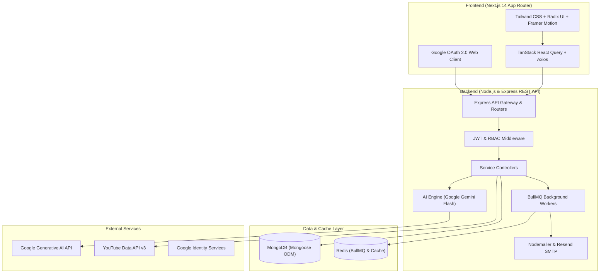

# 🚀 SkillTrack AI

<div align="center">


**Bridge the gap between engineering education and industry career success.**

[](https://nextjs.org/)
[](https://react.dev/)
[](https://www.typescriptlang.org/)
[](https://nodejs.org/)
[](https://www.mongodb.com/)
[](https://ai.google.dev/)
[](https://redis.io/)
[](https://tailwindcss.com/)

[Overview](#-overview) • [Key Features](#-key-features) • [System Architecture](#-system-architecture) • [Tech Stack](#-tech-stack) • [Quick Start](#-quick-start) • [Environment Variables](#-environment-variables) • [Database Seeding](#-database-seeding) • [API Reference](#-api-reference)

</div>

---

## 📖 Overview

**SkillTrack AI** is an intelligent, full-stack career readiness and skill gap analysis platform designed for engineering students, educational institutions, training providers, and administrators.

Traditional academic curricula often lag behind fast-evolving industry requirements. SkillTrack AI bridges this divide by diagnosing a student's real-time competencies against market-verified career roles, generating targeted AI learning roadmaps, delivering adaptive assessments, and tracking placement progression from classroom training through hiring.

---

## ✨ Key Features

### 🎓 For Students & Trainees
- **AI-Powered Skill Gap Analysis**: Dynamically evaluates current proficiencies against target career roles (e.g., Software Development Engineer, Full Stack Developer, AI/ML Engineer) using **Google Gemini AI**.
- **Personalized Day-by-Day Study Plans**: Generates structured, milestone-based learning roadmaps enriched with curated **YouTube** video tutorials and actionable tasks.
- **Adaptive Practice & Assessments**: Timed, multi-difficulty MCQ skill tests with intelligent question pools, instant score breakdown, and answer rationale.
- **Placement Readiness Tracking**: Tracks progress across 7 distinct career milestones:
  `Training Completed` ➔ `Placement Ready` ➔ `Seeking Employment` ➔ `Interview Stage` ➔ `Offer Received` ➔ `Joining Pending` ➔ `Employed`.
- **Opportunities Board**: Browse and apply directly to matching internships, apprenticeships, and job openings.
- **Verified College Onboarding**: Integrated catalog of **65+ accredited Indian engineering institutions** across 28 states and 8 Union Territories, with automated fallback for unlisted college approval requests.
- **Gamified Achievements**: Milestones, badges, and competency growth snapshots over time.

### 👨‍🏫 For Trainers & Mentors
- **Cohort & Batch Monitoring**: Real-time visibility into trainee progress, assessment scores, and skill acquisition trajectories.
- **Target Role Advisory**: Pinpoint critical weaknesses within cohorts to adapt training sessions and curriculum modules.
- **Training Feedback Loops**: Collect and review structured trainee feedback per session.

### 🏛️ For Administrators
- **Executive Analytics Dashboard**: High-level metrics on placement velocity, institutional participation, and skill gaps across cohorts.
- **College Registry Management**: Review, verify, and approve unlisted college submissions with idempotent search token normalization.
- **Career Roles & Competency Benchmarking**: Create and configure role benchmarks, skill weighting (`CRITICAL`, `HIGH`, `MEDIUM`), minimum qualifying thresholds, and recommended scores.
- **Assessment Management**: Create custom skill tests, manage question banks, and review user assessment attempts.
- **Transactional Communication Center**: Monitor email logs, trigger notifications, and manage student consent records.

---

## 🏗️ System Architecture



---

## 💻 Tech Stack

### Frontend
| Technology | Description |
| :--- | :--- |
| **Next.js 14** | React Framework with App Router, SSR, and API optimization |
| **React 18** | Core component UI library |
| **TypeScript** | Strict compile-time type safety |
| **Tailwind CSS** | Utility-first styling with custom dark/light color schemes |
| **Framer Motion** | Fluid animations and micro-interactions |
| **Recharts** | Interactive data visualization and skill radar charts |
| **Radix UI** | Accessible primitives (Dialogs, Dropdowns, Tabs, Avatars) |
| **@tanstack/react-query** | Server state management and automatic caching |
| **Sonner** | Toast notifications |
| **Lucide React** | Clean, consistent UI iconography |

### Backend
| Technology | Description |
| :--- | :--- |
| **Node.js & Express** | Scalable, modular REST API service |
| **TypeScript** | Typed backend code transpiled via `tsc` / `ts-node-dev` |
| **MongoDB & Mongoose** | Document database with compound indexing and schema validation |
| **Google Generative AI** | Google Gemini 2.5 Flash for skill gap diagnostics and study roadmaps |
| **BullMQ & IORedis** | Distributed job queue for background tasks and asynchronous operations |
| **Nodemailer & Resend** | Transactional SMTP email delivery engine |
| **Google Auth Library** | Google OAuth 2.0 token validation |
| **Zod** | Runtime schema validation for requests and AI responses |
| **Multer** | Secure multipart file upload handling |
| **Bcrypt.js & JWT** | Password hashing and secure token-based authentication |

---

## 📁 Repository Structure

```text
SkillTrack/
├── backend/                        # Node.js + Express + TypeScript API
│   ├── src/
│   │   ├── config/                 # Database, Redis, and environment configs
│   │   ├── controllers/            # Route controllers
│   │   ├── data/                   # Seed data (e.g. 65+ Indian colleges dataset)
│   │   ├── middleware/             # Auth, role-based access, error handling
│   │   ├── models/                 # Mongoose schemas (User, Skill, Assessment, etc.)
│   │   ├── routes/                 # Express API endpoints
│   │   ├── scripts/                # Database seed scripts (Admin, Roles, Colleges)
│   │   ├── services/               # AI (Gemini), email, YouTube, and business logic
│   │   ├── utils/                  # Utility functions and custom ApiError class
│   │   ├── validators/             # Zod input validation schemas
│   │   ├── seed.ts                 # Base catalog & initial admin seeder
│   │   └── server.ts               # Main application entry point
│   ├── .env.example                # Backend environment template
│   ├── package.json
│   └── tsconfig.json
│
├── frontend/                       # Next.js 14 App Router Application
│   ├── app/
│   │   ├── (auth)/                 # Login, Register, Forgot Password, Reset Password
│   │   ├── (dashboard)/            # Authenticated application views
│   │   │   ├── achievements/       # Badges & milestone tracking
│   │   │   ├── adaptive-learning/  # AI adaptive quiz engine
│   │   │   ├── admin/              # Comprehensive Admin portal
│   │   │   ├── assessment/         # Skill testing & quiz attempts
│   │   │   ├── career-goal/        # Target role selection & benchmarker
│   │   │   ├── career-status/      # Placement readiness stage pipeline
│   │   │   ├── company-insights/   # Hiring trends & interview insights
│   │   │   ├── dashboard/          # Trainee / student home overview
│   │   │   ├── goals/              # Custom milestone targets
│   │   │   ├── learning/           # Active course modules
│   │   │   ├── notifications/      # In-app notification center
│   │   │   ├── onboarding/         # College & target role onboarding wizard
│   │   │   ├── profile/            # User profile, skills, and credentials
│   │   │   ├── progress/           # Skill growth and readiness analytics
│   │   │   ├── settings/           # Account & notification preferences
│   │   │   ├── skill-gap/          # Visual skill gap breakdown
│   │   │   ├── study-plan/         # Day-wise AI study schedules & videos
│   │   │   └── training-feedback/  # Session feedback submissions
│   │   ├── globals.css             # Global design tokens & styling
│   │   ├── layout.tsx              # Root HTML layout and providers
│   │   └── page.tsx                # Marketing landing page
│   ├── components/                 # Reusable React components (UI, Landing, Admin)
│   ├── lib/                        # Axios client, date utils, custom hooks
│   ├── providers/                  # QueryClient, Theme, and Auth Providers
│   ├── services/                   # Frontend API integration services
│   ├── .env.example                # Frontend environment template
│   ├── package.json
│   └── tailwind.config.ts
│
├── COLLEGES_DATASET.md             # Documentation for Indian Engineering Colleges DB
├── GOOGLE_OAUTH_SETUP.md           # Step-by-step Google Cloud OAuth configuration
└── README.md                       # Main project documentation
```

---

## ⚡ Quick Start

### 📋 Prerequisites
- **Node.js**: v18.x or v20.x+
- **npm** or **yarn** / **pnpm**
- **MongoDB**: Local MongoDB instance (`mongodb://127.0.0.1:27017/skilltrack`) or MongoDB Atlas URI
- **Redis** *(Optional for local dev, recommended for email queues)*: `127.0.0.1:6379`
- **Google Gemini API Key**: Obtain a free API key from [Google AI Studio](https://aistudio.google.com/)

---

### 1️⃣ Clone the Repository

```bash
git clone https://github.com/sarthak-panda-18/SkillTrack.git
cd SkillTrack
```

---

### 2️⃣ Backend Setup

1. **Navigate to the backend directory**:
   ```bash
   cd backend
   ```

2. **Install dependencies**:
   ```bash
   npm install
   ```

3. **Configure environment variables**:
   ```bash
   cp .env.example .env
   ```
   Open `backend/.env` and configure your credentials (at minimum, set `JWT_SECRET` and `GEMINI_API_KEY`).

4. **Seed the Database**:
   Populate skills, colleges, career benchmarks, and assessments:
   ```bash
   # Seed all initial skills and admin account
   npm run seed

   # Seed verified engineering institutions across India
   npm run seed:colleges

   # Seed career roles and role-skill weightings
   npm run seed:career-roles

   # Seed assessments and question banks
   npm run seed:assessments
   ```

5. **Start the backend development server**:
   ```bash
   npm run dev
   ```
   The backend API will run at `http://localhost:5000`.

---

### 3️⃣ Frontend Setup

1. **Open a new terminal and navigate to the frontend directory**:
   ```bash
   cd frontend
   ```

2. **Install dependencies**:
   ```bash
   npm install
   ```

3. **Configure environment variables**:
   Create a `.env.local` file:
   ```bash
   cp .env.example .env.local
   ```
   Ensure `NEXT_PUBLIC_API_URL` points to your backend:
   ```env
   NEXT_PUBLIC_API_URL=http://localhost:5000/api
   NEXT_PUBLIC_GOOGLE_CLIENT_ID=your_google_client_id.apps.googleusercontent.com
   ```

4. **Start the Next.js development server**:
   ```bash
   npm run dev
   ```
   Open [http://localhost:3000](http://localhost:3000) in your browser.

---

## 🔐 Environment Variables

### Backend (`backend/.env`)

| Variable | Required | Default | Description |
| :--- | :---: | :--- | :--- |
| `PORT` | No | `5000` | Port for Express API server |
| `MONGODB_URI` | Yes | `mongodb://127.0.0.1:27017/skilltrack` | MongoDB connection URI |
| `JWT_SECRET` | **Yes** | — | Secret string used to sign JWT tokens |
| `JWT_EXPIRES_IN` | No | `7d` | Token expiration lifespan |
| `CLIENT_URL` | No | `http://localhost:3000` | Allowed CORS frontend origin |
| `GEMINI_API_KEY` | Recommended | — | Google Gemini AI Studio API key |
| `GEMINI_MODEL` | No | `gemini-2.5-flash` | Gemini model variant |
| `AI_DAILY_REQUEST_LIMIT` | No | `20` | Daily limit per student for AI calls |
| `YOUTUBE_API_KEY` | No | — | YouTube Data API v3 key for video lessons |
| `ADMIN_EMAIL` | No | — | Pre-seeded Superadmin email |
| `ADMIN_PASSWORD` | No | — | Pre-seeded Superadmin password |
| `GOOGLE_CLIENT_ID` | Optional | — | Google Cloud OAuth 2.0 Web Client ID |
| `GOOGLE_CLIENT_SECRET` | Optional | — | Google Cloud OAuth 2.0 Client Secret |
| `GOOGLE_CALLBACK_URL` | Optional | `http://localhost:5000/api/auth/google/callback` | OAuth redirect callback |
| `SMTP_HOST` | Optional | `smtp.resend.com` | SMTP host for outbound emails |
| `SMTP_PORT` | Optional | `465` | SMTP port |
| `SMTP_USER` | Optional | `resend` | SMTP username |
| `SMTP_PASS` | Optional | — | SMTP password / API token |
| `EMAIL_FROM` | Optional | `SkillTrack AI <onboarding@resend.dev>` | Outbound sender address |
| `REDIS_HOST` | Optional | `127.0.0.1` | Redis host for BullMQ queues |
| `REDIS_PORT` | Optional | `6379` | Redis port |
| `REDIS_PASSWORD` | Optional | — | Redis password |

### Frontend (`frontend/.env.local`)

| Variable | Required | Default | Description |
| :--- | :---: | :--- | :--- |
| `NEXT_PUBLIC_API_URL` | **Yes** | `http://localhost:5000/api` | Backend API base URL |
| `NEXT_PUBLIC_GOOGLE_CLIENT_ID` | Optional | — | Google OAuth Client ID for web login |

---

## 🗄️ Database Seeding & Data Catalogs

SkillTrack comes equipped with comprehensive idempotent seed scripts:

```bash
# In backend/
npm run seed                # Initializes foundational technical skills & superadmin
npm run seed:colleges       # Imports verified Indian Engineering Institutions (IITs, NITs, IIITs, State & Private)
npm run seed:career-roles   # Benchmarks tech careers (SDE, Full Stack, Data Science, DevOps, etc.)
npm run seed:assessments    # Generates assessment templates & initial question banks
```

> 💡 **College Dataset Details**: See [`COLLEGES_DATASET.md`](COLLEGES_DATASET.md) for details on the normalization pipeline, search indexing, and institution categorization across India's 28 States and 8 Union Territories.

> 🔑 **Google OAuth Configuration**: See [`GOOGLE_OAUTH_SETUP.md`](GOOGLE_OAUTH_SETUP.md) for step-by-step instructions on setting up Google Cloud Console credentials and redirect URIs.

---

## 📡 API Reference Overview

The backend exposes RESTful endpoints with consistent JSON responses:

| Module | Route Prefix | Key Endpoints | Description |
| :--- | :--- | :--- | :--- |
| **Auth** | `/api/auth` | `POST /register`, `POST /login`, `POST /google`, `POST /forgot-password` | Authentication & token generation |
| **Users** | `/api/users` | `GET /profile`, `PUT /profile`, `POST /onboarding` | Profile management & user onboarding |
| **Skills** | `/api/skills` | `GET /`, `GET /my-skills`, `POST /my-skills` | Master skill catalog & user skill ratings |
| **Colleges** | `/api/colleges` | `GET /search`, `POST /request-unlisted` | Search institution registry & request unlisted |
| **Career Roles** | `/api/career-roles` | `GET /`, `GET /:id` | Pre-defined roles, descriptions, and skill weightings |
| **Skill Gap** | `/api/skill-gap` | `GET /current`, `POST /analyze` | AI-driven gap computation & recommendation generation |
| **Roadmap** | `/api/roadmap` | `GET /current`, `POST /generate` | Custom multi-phase learning roadmap |
| **Study Plan** | `/api/study-plan` | `GET /current`, `POST /generate` | Day-by-day learning tasks with YouTube integrations |
| **Adaptive** | `/api/adaptive-learning` | `GET /quiz`, `POST /submit` | Dynamic weakness-focused quiz generation |
| **Assessments** | `/api/assessments` | `GET /`, `POST /:id/start`, `POST /:id/submit` | Timed skill tests & scoring engine |
| **Career Status**| `/api/career-status` | `GET /`, `PUT /stage` | 7-stage placement readiness tracker |
| **Goals** | `/api/goals` | `GET /`, `POST /`, `PUT /:id` | Student learning milestones & targets |
| **Opportunities**| `/api/opportunities` | `GET /`, `GET /:id` | Internships, job posts, and application links |
| **Admin** | `/api/admin` | `GET /metrics`, `GET /users`, `GET /colleges` | Comprehensive system oversight & approvals |
| **Notifications**| `/api/notifications` | `GET /`, `PUT /:id/read`, `PUT /read-all` | User alerts and preference toggles |

---

## 👥 Role-Based Access Control (RBAC)

SkillTrack AI enforces granular role-based security:

| Feature / Access | Student | Trainer | Admin |
| :--- | :---: | :---: | :---: |
| Self-Assessment & Skill Gap Diagnostics | ✅ | ✅ | ✅ |
| Personal AI Study Roadmaps & Quizzes | ✅ | ❌ | ❌ |
| Placement Readiness Stage Updates | ✅ | ✅ | ✅ |
| Cohort Progress & Trainee Oversight | ❌ | ✅ | ✅ |
| Session Feedback Collection | ❌ | ✅ | ✅ |
| Manage College Directory & Approve Requests | ❌ | ❌ | ✅ |
| Modify Career Benchmark Competencies | ❌ | ❌ | ✅ |
| System Metrics & Email Delivery Logs | ❌ | ❌ | ✅ |
| User Status Moderation (Activate/Suspend) | ❌ | ❌ | ✅ |

---

## 🛠️ Development Scripts

### Backend (`/backend`)
```bash
npm run dev                 # Start dev server with auto-reload (ts-node-dev)
npm run build               # Compile TypeScript to dist/
npm run start               # Run compiled production server
npm run seed                # Seed core skills and admin
npm run seed:colleges       # Seed engineering colleges
npm run seed:career-roles   # Seed career paths
npm run seed:assessments    # Seed assessments and question banks
```

### Frontend (`/frontend`)
```bash
npm run dev                 # Start Next.js development server
npm run build               # Create optimized production build
npm run start               # Run Next.js production server
npm run lint                # Run ESLint validation
```

---

## 🤝 Contributing

Contributions are welcome! Please follow these steps:
1. **Fork** the repository.
2. **Create a feature branch**: `git checkout -b feature/amazing-feature`.
3. **Commit your changes**: `git commit -m 'feat: Add amazing feature'`.
4. **Push to the branch**: `git push origin feature/amazing-feature`.
5. **Open a Pull Request**.

---

## 📄 License

This project is licensed under the [MIT License](LICENSE).

<div align="center">
Built with ❤️ for students, educators, and future-ready institutions.
</div>
